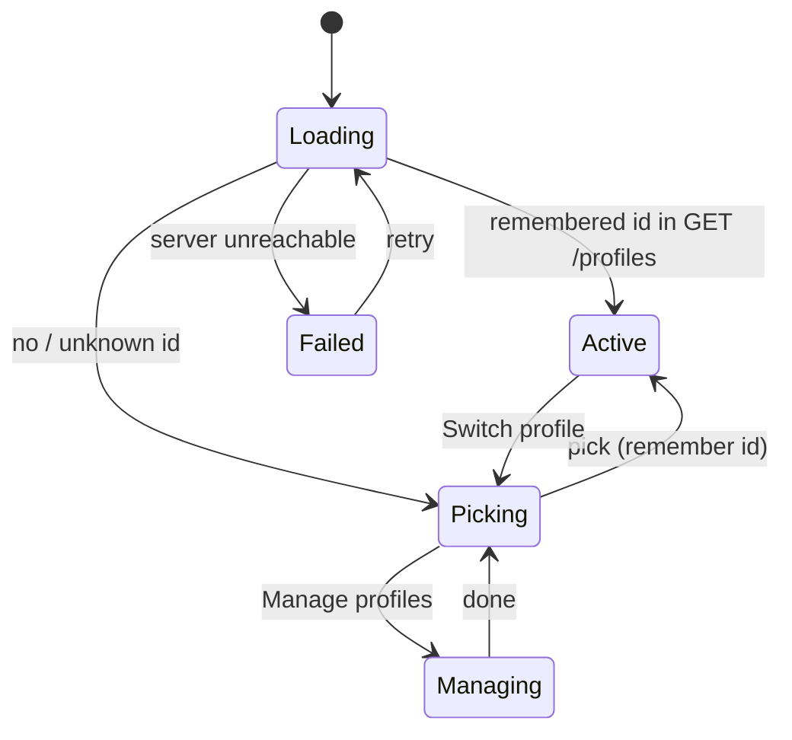

# State machine diagram — profiles — active profile in the web

> **Feature**: UC8 Pick a profile — [spec](../../specs/profiles.md)
> **Related ADRs**: ADR-0008

## Context

The web app's lifecycle around the active profile; the catalog only renders in
`Active`.

## Diagram

## Notes

- A profile deleted from another device is caught at the next `Loading`: its id is no
  longer in `GET /profiles`. Until then its saves answer `404` and are dropped like any
  failed save (ADR-0007, spec 6a).
- `Managing` is the UC9 screen; deleting the last profile is refused, so `Picking`
  always lists at least one profile.
