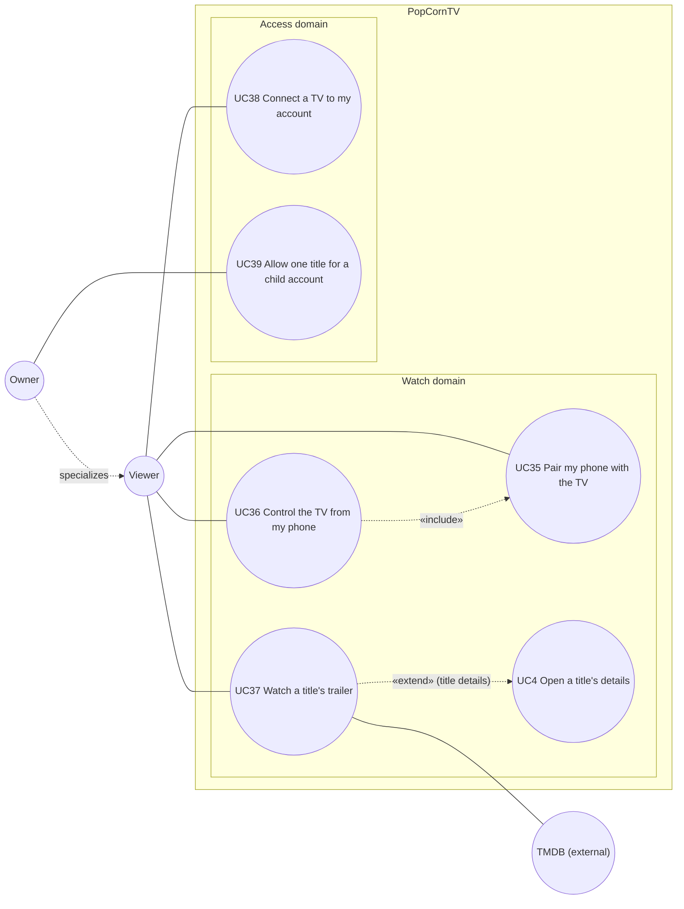

# Use case diagram — redesign — new goals

> **Feature**: front-end redesign, epic #401 (#396) — [brief](../../../requirements/04-redesign-brief.md),
> [personas](../../../requirements/06-personas.md), [screen inventory](../../specs/redesign-screen-inventory.md)
> **Related ADRs**: ADR-0038, ADR-0039

## Context

Only the goals the redesign adds. The goals that exist today stay in their own domain diagrams
and are not redrawn: [playback](../playback/01-use-case.md) (UC1–UC10),
[catalog](../catalog/01-use-case.md) (UC3, UC4, UC22, UC24, UC26–UC30),
[auth](../auth/01-use-case.md) (UC15 and the account goals). UC31 and UC34 are reserved by
other branches (#128, #315), so the new goals start at UC35. The TV and the phone are devices,
not actors: the same Viewer uses them.

## Diagram

## Notes

- **UC35** — the Viewer pairs a phone with the TV app through the PopCornTV server (D6); the
  feature is #418. Pairing is a precondition of UC36, hence «include».
- **UC36** — browse, pick, play / pause, ±10 s, seek, volume, audio and subtitles, arrows / OK /
  Back from the phone (J1). It drives UC3, UC4 and UC5 on the TV through ADR-0039 paths.
- **UC37** — extends UC4 at the *Trailer* button: a local trailer plays in PopCornTV's player, a
  remote one is handed to a personal device (ADR-0038). TMDB gives the trailer key to the
  server only.
- **UC38** — signs the TV app in without typing a password (#200, #417).
- **UC39** — the Owner allows one title above a child account's rating (J8). Restrictions apply
  per account (REQ-26, REQ-27, UC15); the feature and its specification are #316. The redesign
  only draws its control.
- Activities: [choose a title](07-activity-choose-a-title.md),
  [play and resume](07-activity-play-and-resume.md),
  [pair the phone remote](07-activity-pair-phone-remote.md),
  [child session](07-activity-child-session.md).
