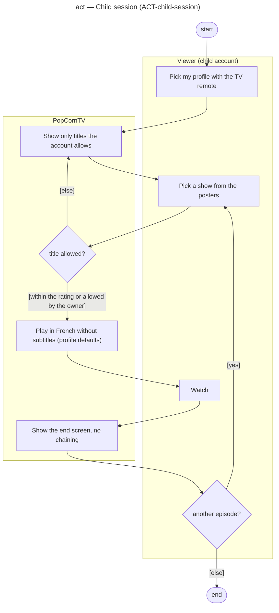

# Activity diagram — redesign — child session

> **Feature**: UC3, UC5, UC39 — J4, J8; restriction per account (REQ-26, REQ-27, #316)
> **Related ADRs**: ADR-0008, ADR-0039

## Diagram

## Notes

- The child chooses the next episode on purpose; nothing chains on its own (J4).
- The owner's per-title allowance (UC39, J8) is set from the title details on the owner's
  account; its rules are specified in #316. J4 and J8 say "profile"; #316 decides per account.
- No typing: the profile picker and the posters work with arrows, OK and Back (NFR-15).
