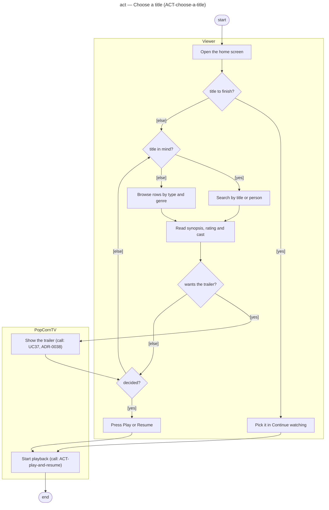

# Activity diagram — redesign — choose a title

> **Feature**: UC3, UC4, UC22, UC24, UC37 — J2, J3, J6, goal G3
> **Related ADRs**: ADR-0038, ADR-0039

## Diagram

## Notes

- Continue watching plays in one activation (G3); the hero offers Play or Resume in at most two.
- The trailer runs only on request; nothing starts with sound unasked (G7).
- A suggestions row (J2, #160) would sit beside the rows in *Browse rows*; drawn as a reserved
  slot only.
