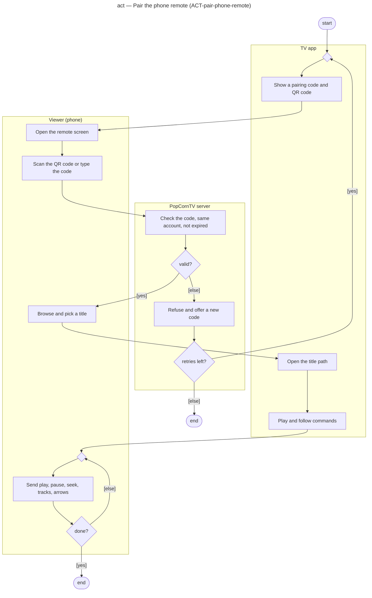

# Activity diagram — redesign — pair the phone remote

> **Feature**: UC35, UC36 — J1, decision D6 (feature #418)
> **Related ADRs**: ADR-0041

## Diagram

## Notes

- Pairing and commands go through the PopCornTV server only (NFR-14); no Google Cast (#202).
- The phone sends the TV an ADR-0041 path, so the TV opens exactly the title or view picked.
- Code lifetime, retry limits and unpairing are specified in #418. `M1`, `M2` are merge nodes.
- The pairing code travels in the hash of the QR link, never in a path (ADR-0041).
