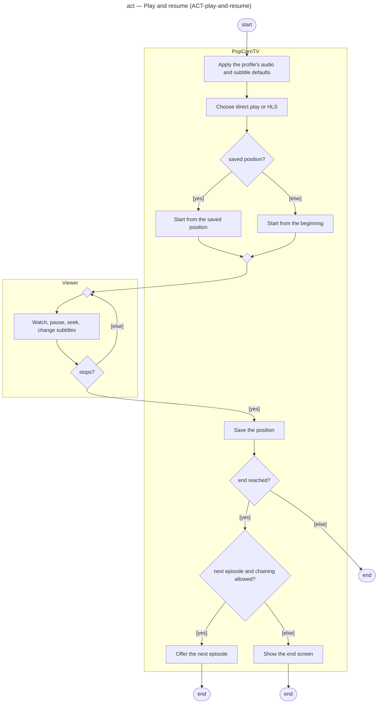

# Activity diagram — redesign — play and resume

> **Feature**: UC5, UC6, UC7, UC10 — J5, J6, goals G2, G4
> **Related ADRs**: ADR-0005, ADR-0006, ADR-0007, ADR-0019, ADR-0041

## Diagram

## Notes

- The audio choice comes before direct play or HLS: a non-default track forces HLS (ADR-0019).
- The position is also saved every 10 s and on pause (ADR-0007); *Save the position* is the
  final save on stop. `M1`, `M2` are merge nodes.
- Space pauses and Back closes the player (#415, G2); every action works with arrows, OK and
  Back (G4).
- Switching the audio track while playing needs a new HLS session (ADR-0019); it is filed
  separately and drawn as an entry point only. The player controls (D5) are decided in #399.
- A child account never chains episodes (J4); the end screen gives a clear stop.
- A reload on a `/play/…` path reopens the title with *Resume*, never playback (ADR-0041).
