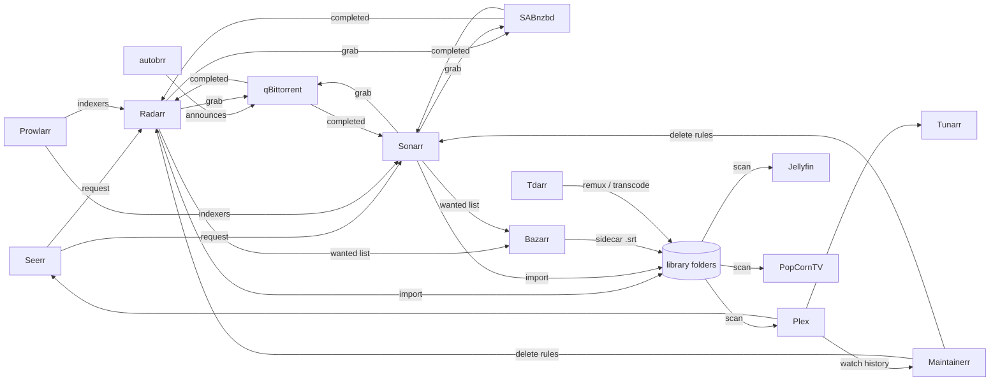

# Homelab ecosystem around PopCornTV

What each media tool of the owner's homelab does, how it relates to PopCornTV, and the
decisions taken on 2026-11-05 (issue #26): PopCornTV replaces Jellyfin only, coexists with
everything else and calls none of it.

## Inventory

The media-related services of the homelab on 2026-11-05. Versions were not recorded; later
checks should start by noting them. Unrelated services (file sync, documents, home
automation, remote coding) are left out on purpose.

| Group | Services |
|---|---|
| Media servers | Jellyfin, Plex |
| Around the servers | Seerr (discover and request), Tunarr (live TV channels from the library), Maintainerr (retention rules) |
| Library automation | Radarr (movies), Sonarr (series), Lidarr (music), Bazarr (subtitles), Prowlarr (indexers), autobrr (release announcements), qBittorrent and SABnzbd (download clients), Tdarr (file health and transcoding) |
| Operations | Uptime Kuma (endpoint availability), Grafana (server metrics) |

## How the media chain works

Everything upstream of the library, Tdarr apart, is acquisition. The vision
([01-vision.md](01-vision.md) § Product) keeps it out of the product: no content source, no
indexer, no download feature, and PopCornTV never calls these tools (owner decision
2026-10-23, MCDA coexistence 450 / read-only integration 380 / full integration 170).
Whatever lands in a library folder is picked up by the next scan. Scans are manual today:
the only trigger is the owner-only `POST /libraries/:id/scan` (library-scan spec), there is
no scheduler or watcher, and after #18 no non-cookie token lets a cron job call it. Every
decision below inherits that limit; see Consequences.

## Triage

| Tool | Decision | Relation with PopCornTV | Why |
|---|---|---|---|
| Jellyfin | Replaced | PopCornTV takes its place (#60) | The project goal. |
| Plex | Kept | None, coexistence | Backend of Seerr, Maintainerr and Tunarr. Removing it would break the three. |
| Seerr | Kept | One link from the PopCornTV UI, nothing else | Wishlist with request approval already exists (D1). |
| Radarr, Sonarr | Kept | None, never called | The 2026-10-23 decision. Their API key is an unscoped admin key, so a compromised PopCornTV could delete the library. |
| Bazarr | Kept | None | It writes sidecar `.srt` files; the scanner reads embedded tracks only (ADR-0009 §1). A Tdarr flow muxes them into the files (D3). |
| Tdarr | Kept | None | Works on files upstream. A remux to MP4 makes most files direct-playable, since only `mp4`, `m4v` and `webm` containers direct-play (`decidePlayback`, ADR-0005); an MKV always goes through HLS, streams copied when H.264/AAC (ADR-0006). D4 sets the flow. |
| Maintainerr | Kept | None | Reads watch history from Plex. Exporting `watch_progress` would break profiles spec R6 (history never sent out); doing retention in PopCornTV would mean deleting files. Caveat: once the household watches in PopCornTV, Plex no longer sees that viewing, so any "not watched for N days" rule would delete titles the family does watch. The rules must be audited before the cut-over (#60). |
| Tunarr | Kept | None | Reads Plex, Jellyfin, Emby or local files. Plex stays, nothing to do. |
| Uptime Kuma | Kept | Probe on `/api/health` through Caddy | Zero code; `/health` stays public after #18 (auth spec § 4.3). Checklist of #60. |
| Grafana | Kept | None | Server metrics. No application metrics need today (YAGNI). |
| Prowlarr, autobrr, qBittorrent, SABnzbd | Kept | Never | Acquisition chain, excluded by the vision. |
| Lidarr | Kept | Never | Music is out of scope. |

## Decisions (MCDA, 2026-11-05)

Scale 0–5, weights sum to 100, totals out of 500, each cell with its reason. The owner
validated the weights and the top score of each matrix on the corrected totals.

### D1 — a child viewer's wishlist

| Criterion (weight) | A. Keep Seerr, link from PopCornTV | B. Local wishlist, fulfilled by hand | C. Pull import list read by Radarr / Sonarr | D. PopCornTV calls the Radarr / Sonarr API |
|---|---|---|---|---|
| Family value (30) | 3 — works today in Seerr, but outside the app and visible in PopCornTV only after a manual rescan | 3 — in the app, human delay, same rescan | 4 — automatic, follow-up outside the app | 5 — all in the app |
| Standing decision and security (30) | 5 — nothing changes | 5 — no network egress | 4 — PopCornTV calls nothing, but needs a non-cookie token route | 1 — reverses 2026-10-23, stores an admin key |
| Effort (20) | 5 — one link | 4 — a table and two screens | 3 — route plus TVDB mapping | 2 — client, allow-list, mapping, return webhook |
| Parental approval (20) | 5 — native in Seerr | 5 — the owner is the approval | 3 — to build | 3 — to build |
| Points | 90 + 150 + 100 + 100 | 90 + 150 + 80 + 100 | 120 + 120 + 60 + 60 | 150 + 30 + 40 + 60 |
| **Total** | **440** | **420** | **360** | **280** |

Sensitivity: family value at 50 and decision at 10 gives A 400, B 380, C 360, D 360. A
stays first. **Chosen: A.** Seerr with Plex as its media server covers sign-in, availability
and request approval (Seerr docs). The link in the UI is a follow-up issue, filed after #18
(see Consequences).

### D2 — backend for Seerr, Maintainerr and Tunarr once Jellyfin is gone

| Criterion (weight) | A. Plex stays as their backend | B. Headless Jellyfin kept for them | C. PopCornTV absorbs their role | D. PopCornTV exposes a Jellyfin-compatible API |
|---|---|---|---|---|
| Effort (40) | 5 — nothing to do | 4 — one more service to run | 1 — three products to rewrite | 0 — a large foreign API surface |
| Tools keep working (40) | 4 — all three support Plex, but Maintainerr loses the viewing that moves to PopCornTV (rules to audit) | 5 — all three support Jellyfin, same blind spot | 2 — Tunarr and Maintainerr lost | 3 — partial emulation at best |
| Fits the vision (20) | 5 — PopCornTV stays a player | 2 — Jellyfin never goes | 1 — live TV and file deletion are excluded by the vision | 3 — a foreign API, no new feature |
| Points | 200 + 160 + 100 | 160 + 200 + 40 | 40 + 80 + 20 | 0 + 120 + 60 |
| **Total** | **460** | **400** | **140** | **180** |

Sensitivity: tools at 60 and effort at 20 gives A 440, B 420. A stays first. **Chosen: A.**
Tunarr can also read local files directly, which removes its dependency on any media server
if Plex ever goes.

### D3 — subtitles from Bazarr

| Criterion (weight) | A. Embedded tracks only (today, ADR-0009) | B. Sidecar brick in PopCornTV | C. Mux Bazarr's sidecars into the files with Tdarr |
|---|---|---|---|
| Viewer value (35) | 2 — Bazarr's subtitles invisible | 5 — every subtitle shown | 5 — every subtitle shown, as embedded tracks (SRT only; ASS styling is lost in MP4) |
| Effort in PopCornTV (30) | 5 — none | 2 — new ADR, naming patterns, track namespace, path guard, cache key, rescan trigger | 5 — none |
| Risk (20) | 5 — none | 3 — new file path to confine, the `:index` contract changes | 2 — the file is rewritten: `:index` can point at another stream until the next rescan (subtitles R2), progress is lost if the path changes (#62), Bazarr may re-download a sidecar it no longer sees unless its embedded-subtitle detection is on |
| Fits the stack (15) | 3 — ignores a tool that is already there | 4 — PopCornTV does the work | 5 — Tdarr already runs on every file |
| Points | 70 + 150 + 100 + 45 | 175 + 60 + 60 + 60 | 175 + 150 + 40 + 75 |
| **Total** | **365** | **355** | **440** |

Sensitivity: risk at 35 and viewer value at 20 gives A 410, C 395, B 325. The status quo
wins when risk dominates, so C holds only with a scan trigger (Consequences). **Chosen: C**,
as a homelab configuration, not a PopCornTV feature. A is the runner-up by score and the
fallback; B needs its own ADR superseding ADR-0009 §1 and is not planned.

### D4 — file health and transcoding

| Criterion (weight) | A. Tdarr remuxes to MP4, re-encodes only codecs no browser decodes, converts text subtitles to `mov_text` | B. PopCornTV live HLS only (today) | C. PopCornTV runs its own background transcoding |
|---|---|---|---|
| Playback quality (35) | 4 — direct play for most files; PGS subtitles dropped, ASS styling lost | 3 — one FFmpeg per play, streams copied for H.264/AAC, EVENT playlist, 60 s idle watchdog | 5 — same as A without the subtitle loss, at our cost |
| Effort in PopCornTV (30) | 5 — none | 5 — none | 1 — a job queue, storage, a UI |
| Server load (20) | 4 — one pass per file, then none | 3 — a copy per play, a re-encode for HEVC and others | 4 — one pass per file |
| Scope (15) | 5 — stays "player" | 5 — stays "player" | 1 — file management, excluded by the vision |
| Points | 140 + 150 + 80 + 75 | 105 + 150 + 60 + 75 | 175 + 30 + 80 + 15 |
| **Total** | **445** | **390** | **300** |

Sensitivity: quality at 20 and effort at 45 gives A 460, B 420; server load at 35 and
quality at 20 gives A 445, B 390. A stays first, B is close whenever quality weighs less.
**Chosen: A.** The remux changes the path, so #62 must make resume progress survive a path
change before the cut-over, and a manual rescan follows each Tdarr run until a scan trigger
exists.

## Consequences

- #26 closes with this document.
- To add on #62 (parity matrix) at merge: a cut-over prerequisite, resume progress survives
  a file replaced on another path by a Radarr / Sonarr upgrade or a Tdarr remux
  (`watch_progress.media_id` cascades on delete; a replacement on the same path keeps the
  row).
- To add on #60 (homelab deploy) at merge: the Uptime Kuma probe, the Tdarr flow of D4
  (keep text subtitle streams), the Bazarr mux of D3 with embedded-subtitle detection on,
  an audit of the Maintainerr rules (keep only rules not based on watch state, or dry-run),
  and a one-shot import of Jellyfin's watch history.
- To file after #18: the Seerr link in the PopCornTV UI (D1), and a scheduled library scan
  inside the server, which D1, D3 and D4 all depend on. Until it exists the owner rescans by
  hand.
- No integration brick is planned. The 2026-10-23 decision and the single HTTP egress to
  TMDB stand.

## Facts checked (2026-11-05, official docs)

- Seerr runs with Plex, Jellyfin or Emby and ships request approval and a permission system.
- Maintainerr supports Plex, Jellyfin and Emby and builds rules from the media server plus
  Radarr, Sonarr, Seerr, Tautulli and others.
- Tunarr reads Plex, Jellyfin, Emby and local files.
- Not checked, not needed after D1: the Radarr / Sonarr v3 add payloads.
- Not checked: which Maintainerr rules the owner runs, and Bazarr's re-download behaviour
  after a mux.
