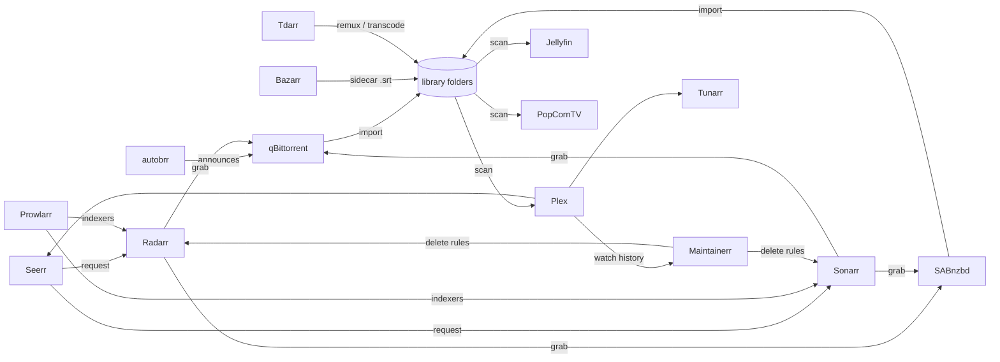

# Homelab ecosystem around PopCornTV

What each tool of the owner's homelab does, how it relates to PopCornTV, and the decisions
taken on 2026-11-05 (issue #26): PopCornTV replaces Jellyfin only, coexists with everything
else and calls none of it.

## Inventory

The homelab dashboard on 2026-11-05 lists the services below. Versions were not recorded;
later checks should start by noting them.

| Group | Services |
|---|---|
| Media | Jellyfin, Plex, Seerr (discover and request), Tunarr (live TV channels from the library) |
| Library automation | Radarr (movies), Sonarr (series), Lidarr (music), Bazarr (subtitles), Prowlarr (indexers), autobrr (release announcements), qBittorrent and SABnzbd (download clients behind a Mullvad VPN), Tdarr (file health and transcoding), Maintainerr (retention rules) |
| Operations | Grafana, Uptime Kuma, Syncthing, T3 Code |
| Daily services | Nextcloud, Immich, Vaultwarden, Paperless, Miniflux, Forgejo, Home Assistant |

## How the media chain works

Everything left of the library is acquisition. The vision
([01-vision.md](01-vision.md) § Product) keeps it out of the product: no content source, no
indexer, no download feature, and PopCornTV never calls these tools (owner decision
2026-10-23, MCDA coexistence 450 / read-only integration 380 / full integration 170).
Whatever lands in a library folder is picked up by the next scan.

## Triage

| Tool | Decision | Relation with PopCornTV | Why |
|---|---|---|---|
| Jellyfin | Replaced | PopCornTV takes its place (#60) | The project goal. |
| Plex | Kept | None, coexistence | Backend of Seerr, Maintainerr and Tunarr. Removing it would break the three. |
| Seerr | Kept | One link from the PopCornTV UI, nothing else | Wishlist with request approval already exists (MCDA below). |
| Radarr, Sonarr | Kept | None, never called | The 2026-10-23 decision. Their API key is an unscoped admin key, so a compromised PopCornTV could delete the library. |
| Bazarr | Kept | None for now | It writes sidecar `.srt` files; the scanner reads embedded tracks only (ADR-0009 §1). A sidecar brick would supersede that ADR, to be decided on a real need (MCDA below). |
| Tdarr | Kept | None | Works on files upstream; pre-transcoding to H.264/AAC raises direct play. It cannot know PopCornTV's direct-play rate, which depends on each browser (ADR-0005). Deploy note in #60: keep text subtitle streams, rescan after its runs. |
| Maintainerr | Kept | None | Reads watch history from Plex. Exporting `watch_progress` would break profiles spec R6 (history never sent out); doing retention in PopCornTV would mean deleting files. |
| Tunarr | Kept | None | Reads Plex, Jellyfin, Emby or local files. Plex stays, nothing to do. |
| Uptime Kuma | Kept | Probe on `/api/health` through Caddy | Zero code; `/health` stays public after #18 (auth spec § 4.3). Checklist of #60. |
| Grafana | Kept | None | Server metrics. No application metrics need today (YAGNI). |
| Prowlarr, autobrr, qBittorrent, SABnzbd | Kept | Never | Acquisition chain, excluded by the vision. |
| Lidarr | Kept | Never | Music is out of scope. |
| Syncthing, T3 Code, daily services | Kept | None | Unrelated to media. |

## Decisions (MCDA, 2026-11-05)

Scale 0–5, weights sum to 100, totals out of 500. The owner validated the weights and the
top score of each matrix.

### D1 — the daughter's wishlist

| Criterion (weight) | A. Keep Seerr, link from PopCornTV | B. Local wishlist, fulfilled by hand | C. Pull import list read by Radarr / Sonarr | D. PopCornTV calls the Radarr / Sonarr API |
|---|---|---|---|---|
| Family value (30) | 4 — works today, outside the app | 3 — in the app, human delay | 4 — automatic, follow-up outside the app | 5 — all in the app |
| Standing decision and security (30) | 5 — nothing changes | 5 — no network egress | 4 — PopCornTV calls nothing, but needs a non-cookie token route | 1 — reverses 2026-10-23, stores an admin key |
| Effort (20) | 5 — one link | 4 — a table and two screens | 3 — route plus TVDB mapping | 2 — client, allow-list, mapping, return webhook |
| Parental approval (20) | 5 — native in Seerr | 5 — the owner is the approval | 3 — to build | 3 — to build |
| **Total** | **470** | **420** | **360** | **280** |

Sensitivity: family value at 50 and decision at 10 keeps A first (450 against D 360).
**Chosen: A.** Seerr with Plex as its media server covers sign-in, availability and request
approval (Seerr docs). The link in the UI is a separate issue after #18.

### D2 — backend for Seerr, Maintainerr and Tunarr once Jellyfin is gone

| Criterion (weight) | A. Plex stays as their backend | B. Headless Jellyfin kept for them | C. PopCornTV absorbs their role | D. PopCornTV exposes a Jellyfin-compatible API |
|---|---|---|---|---|
| Effort (40) | 5 — nothing to do | 4 — one more service to run | 1 — three products to rewrite | 0 — a large foreign API surface |
| Tools keep working (40) | 5 — all three support Plex | 5 — all three support Jellyfin | 2 — Tunarr and Maintainerr lost | 3 — partial emulation at best |
| Fits the goal "replace Jellyfin" (20) | 5 | 2 — Jellyfin never goes | 4 | 3 |
| **Total** | **500** | **400** | **200** | **180** |

**Chosen: A.** Tunarr could also read local files directly, which removes its dependency on
any media server if Plex ever goes.

### D3 — subtitles from Bazarr

| Criterion (weight) | A. Embedded tracks only (today, ADR-0009) | B. Sidecar brick in PopCornTV | C. Mux Bazarr's sidecars into the files with Tdarr |
|---|---|---|---|
| Viewer value (35) | 2 — Bazarr's subtitles invisible | 5 — every subtitle shown | 5 — every subtitle shown, as embedded tracks |
| Effort in PopCornTV (30) | 5 — none | 2 — new ADR, naming patterns, track namespace, path guard, cache key, rescan trigger | 5 — none |
| Risk (20) | 5 — none | 3 — new file path to confine, `:index` contract changes | 3 — a Tdarr flow rewrites files, progress cascade on replacement (#62) |
| Fits the stack (15) | 3 | 4 | 5 — Tdarr already runs on every file |
| **Total** | **320** | **375** | **450** |

**Chosen: C**, as a homelab configuration, not a PopCornTV feature. B stays the fallback if
the Tdarr flow proves unreliable, and it needs its own ADR superseding ADR-0009 §1.

### D4 — file health and transcoding

| Criterion (weight) | A. Tdarr pre-transcodes to H.264/AAC, PopCornTV transcodes live only the rest | B. PopCornTV live HLS only (today) | C. PopCornTV runs its own background transcoding |
|---|---|---|---|
| Playback quality (35) | 5 — direct play for most files | 3 — FFmpeg per session, 60 s idle watchdog | 5 |
| Effort in PopCornTV (30) | 5 — none | 5 — none | 1 — a job queue, storage, a UI |
| Server load (20) | 4 — one pass per file | 2 — re-encode on every play | 4 |
| Scope (15) | 5 — stays "player" | 5 | 1 — file management, excluded by the vision |
| **Total** | **470** | **370** | **275** |

**Chosen: A.** Tdarr's flow must keep text subtitle streams, and #62 must make resume
progress survive a file replacement before the cut-over.

## Consequences

- #26 closes with this document.
- #62 (parity matrix) gains a cut-over prerequisite: resume progress survives a file replaced
  by Radarr, Sonarr or Tdarr (`watch_progress.media_id` cascades on delete today).
- #60 (homelab deploy) gains the Uptime Kuma probe, the Tdarr deploy note, the Bazarr mux
  flow and a one-shot import of Jellyfin's watch history.
- No integration brick is planned. The 2026-10-23 decision and the single HTTP egress to
  TMDB stand.

## Facts checked (2026-11-05, official docs)

- Seerr runs with Plex, Jellyfin or Emby and ships request approval and a permission system.
- Maintainerr supports Plex, Jellyfin and Emby and builds rules from the media server plus
  Radarr, Sonarr, Seerr, Tautulli and others.
- Tunarr reads Plex, Jellyfin, Emby and local files.
- Not checked, not needed after D1: the Radarr / Sonarr v3 add payloads.
